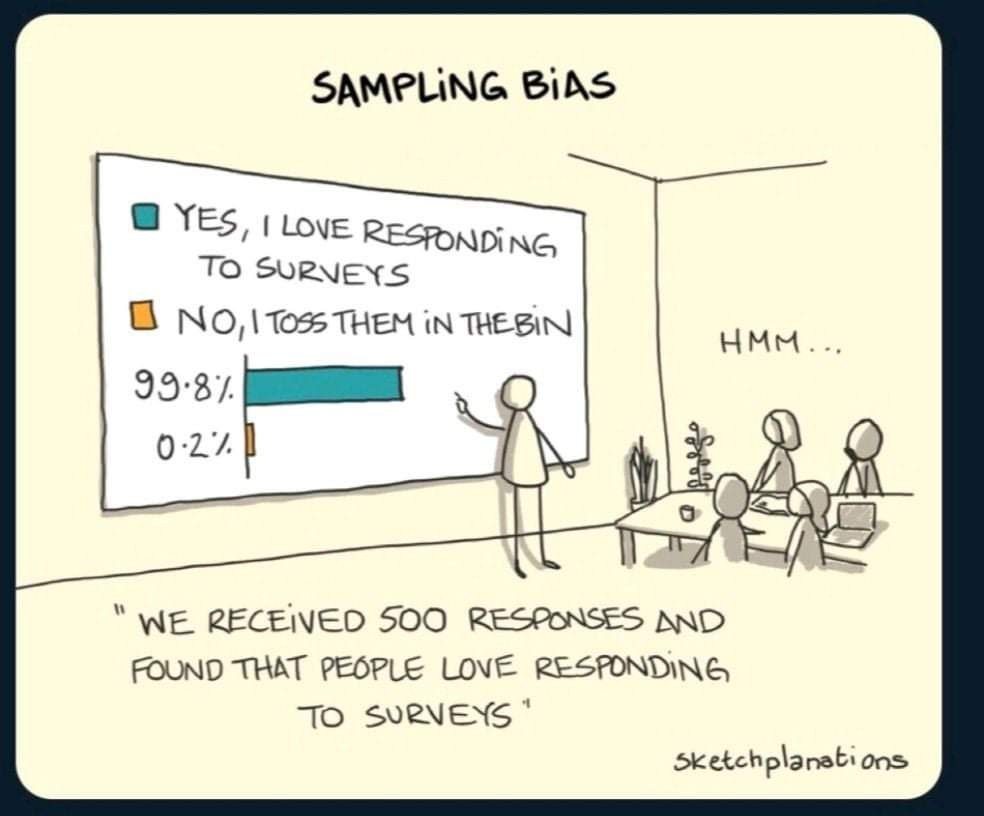
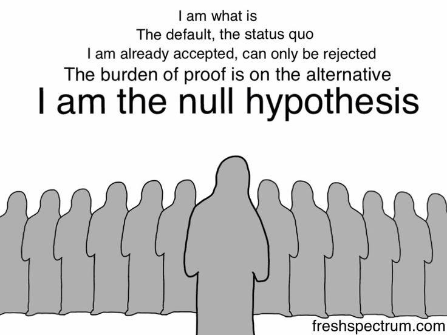
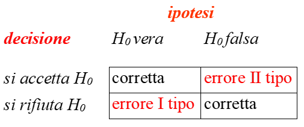
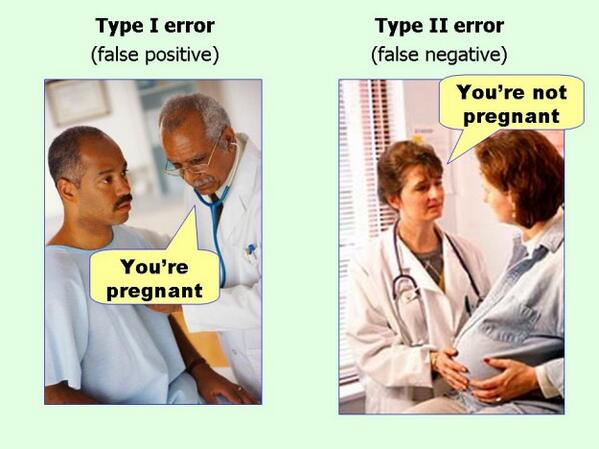

# Inferenza statistica

### 

L'**inferenza statistica** è definita come un insieme di metodi, basati sulla teoria della probabilità, tali per cui si possano trarre conclusioni plausibili sulla variabile casuale associata ad una particolare caratteristica di una *popolazione* a partire dall'osservazione di un **campione** di elementi della popolazione stessa.

\vspace{3mm}

Secondo l'impostazione classica, la teoria dell'inferenza statistica si sviluppa lungo due direttrici:

- Teoria della **stima di parametri**
- Teoria della **verifica di ipotesi**

### 

La maggior parte degli studi viene condotta su "gruppi" più o meno ampi di elementi che appartengono ad un insieme più ampio definito POPOLAZIONE

:::{.callout-tip}
## Popolazione

Rappresenta tutto l'universo di individui a cui si rivolge l'attenzione del ricercatore (ad es. la popolazione degli studenti della scuola elementare)
:::

:::{.callout-tip}
## Campione

Sottoinsieme della popolazione, possibilmente composto da unità estratte **casualmente** dalla popolazione.
:::

### 

\centering
\small

\textbf{POPOLAZIONE}

:::: {.columns}

::: {.column width=50%}
\centering
Finita ($N$)

\scriptsize

È possibile avere informazioni rispetto al numero di unità di analisi che la compongono

Molto piccola (e.g., persone con sindrome rara) o molto grande (e.g., tutti gli studenti di psicologia)
:::

::: {.column width=50%}
\centering
Infinita

\scriptsize

Non è possibile conoscere con precisione il numero di unità di analisi che la compongono (anche se hanno un numero finito)

Non è possibile determinare il numero di unità di analisi che la compongono (e.g., lanci di un dado)
:::

::::

\vspace{1mm}

\includegraphics[width=0.03\linewidth]{frecciadown.png}

\vspace{1mm}

\textbf{CAMPIONAMENTO}

*con o senza reinserimento*

\vspace{0.5mm}

\includegraphics[width=0.03\linewidth]{frecciadown.png}

\vspace{0.5mm}

**Campione**

*finito* ($n$)

### 

Lo studio *dell'intera popolazione* porta alla **certezza delle conclusioni**

:::{.callout-note}
## Esempio

Si vuole verificare se il reddito familiare medio degli studenti di psicologia in Italia (popolazione A) sia superiore a quello dei loro colleghi in Francia (popolazione B).
Se si calcolasse il reddito medio di tutte le famiglie italiane e francesi il risultato (indipendentemente da quale) sarebbe certo
:::

. . .

Studiare l'intera popolazione è irrealistico (a livello di risorse umane, economiche, temporali ecc.) $\rightarrow$ è necessario l'utilizzo dei campioni e della statistica inferenziale.

### 

Un'*indagine campionaria* **non offre la certezza delle conclusioni**: quello che si osserva su due campioni A e B potrebbe non riflettere la realtà delle popolazioni

Il modo in cui viene selezionato il campione è di fondamentale importanza!!

{width=42% fig-align="center"}

### 

Gli strumenti statistici consentono di valutare **probabilisticamente** gli errori che si possono commettere traendo conclusioni sulle popolazioni a partire dalle caratteristiche di uno o più campioni

\vspace{3mm}

Gli errori di un'indagine campionaria possono essere ridotti se il campione è **rappresentativo** della popolazione; dovrebbe cioè *possedere le caratteristiche della popolazione dalla quale proviene*

:::{.callout-important}
## Campionamento casuale

Se il campione è estratto *casualmente* dalla popolazione si può affermare che eventuali differenze sono dovute "al caso", dovute cioè *a variazioni accidentali e non sistematiche*
:::

### 

Non solo come... ma anche quanto! L'importanza dell'ampiezza campionaria per studi che permettano inferenze "valide"

{width=48% fig-align="center"}

# Stimatore

### 

Un **indicatore o statistica** o più comunemente **STIMATORE** è una funzione dei valori osservati sul campione $(X_1, X_2, \ldots, X_n)$, utilizzato per la stima di un **parametro** (generalmente incognito) di una **popolazione** e che (possibilmente) rispetta una serie di caratteristiche.

\vspace{3mm}

Stima:

- *Stima puntuale*: il metodo di stima conduce ad un unico valore per il parametro in oggetto
- *Stima intervallare*: il metodo di stima conduce ad un intervallo di valori, all'interno dei quali si suppone che si trovi con una certa probabilità il valore vero del parametro

### 

La **statistica inferenziale** ha pertanto l'obiettivo di stimare incogniti parametri attraverso certe funzioni dei dati campionari (*indicatori* o *stimatori*).

\vspace{3mm}

Si calcolano, quindi, le **STATISTICHE** (ad es., $M$) del campione per conoscere i **PARAMETRI** (ad es., $\mu$) della popolazione.

\vspace{3mm}

Questo passaggio dalle STATISTICHE ai PARAMETRI si basa sulla conoscenza delle proprietà delle **DISTRIBUZIONI CAMPIONARIE** delle statistiche (ad es., $M$)

# Test di ipotesi

###

Obiettivi dell'inferenza statistica:

- Stima dei parametri
- **Verifica di ipotesi**

{width=6% fig-align="center"}

Procedura che si svolge per passi logici successivi:

- (Porsi una domanda di ricerca) (dotata di senso) (basata sulla letteratura)
- Formulazione ipotesi riguardanti i parametri della popolazione
- Definizione dei criteri e dei vincoli di accettazione dell'ipotesi
- Raccolta dati campionari
- Valutazione delle ipotesi formulate

###

\small

Le ipotesi di ricerca sono ipotesi statistiche:

- consistono in affermazioni di tipo logico-matematico che definiscono i rapporti fra i parametri di una o più popolazioni
- la verifica delle ipotesi consiste in un **processo di decisione che termina nell'accettazione --o non rifiuto-- delle affermazioni contenute nelle ipotesi stesse**
- Un'ipotesi statistica è un'asserzione o supposizione sulla distribuzione di una o più variabili casuali, o su uno o più parametri della stessa, e si indica con la lettera ***H***.

:::{.callout-note}
## Esempio

Sia $X_1, X_2, \ldots, X_n$ un campione casuale estratto da una popolazione normale con media incognita. Si può formulare l'ipotesi che la media di tale popolazione sia 12. Formalmente si esprime con:
$$\text{H}:\; \mu = 12$$
:::

## Null Hypothesis Significance Testing (NHST)

### Due approcci... e un ibrido

\small

:::: {.columns}

::: {.column width=50%}
**Fisher (1925)**

- Solo $H_0$, nessuna ipotesi alternativa formale
- Il $p$-value indica quanto i dati sono poco compatibili con $H_0$
:::

::: {.column width=50%}
**Neyman e Pearson (1933)**

- $H_0$ contro $H_1$
- $\alpha$ e $\beta$ fissati prima di raccogliere i dati $\rightarrow$ decisione: si rifiuta o non si rifiuta $H_0$
:::

::::

\vspace{3mm}

:::{.callout-important}
## NHST

È una *forzatura* dei due approcci: prende $H_0$ e il $p$-value da Fisher, $H_1$, $\alpha$ e $\beta$ da Neyman e Pearson, e li mette insieme (anche se i due approcci hanno logiche diverse)
:::

###

\small

:::{.callout-tip}
## Ipotesi nulla e ipotesi alternativa

Le distribuzioni di probabilità a livello delle popolazioni che identificano lo schema logico del confronto sono classificate in due gruppi distinti:

- **H$_0$**: definita come **l'ipotesi nulla**
- **H$_A$**: definita come **l'ipotesi alternativa**

L'ipotesi alternativa viene indicata con altri simboli equivalenti come **H$_1$** oppure **K**, che sono di fatto sinonimi del più diffuso H$_A$.
:::

:::{.callout-warning}
## Nota

H$_0$ è definita come la **negazione logica** di H$_A$ e viceversa.

Ad esempio, supponiamo che H$_0$ affermi che $\mu \leq \mu_0$, allora H$_A$ indica la relazione complementare $\mu > \mu_0$.
$$\Theta_0 = (\Theta_A)^c$$
:::

###

1. **Ipotesi $H_0$**: è l'ipotesi che costituisce l'oggetto del test; specifica i valori dei parametri della popolazione da cui si suppone provenga il campione (o i campioni) in esame. Stabilisce che i diversi valori ottenuti nel campione sono puramente **casuali**.
Formalmente si esprime con:
$$H_0: \; \theta = \theta_0$$
dove $\theta$ indica il parametro della popolazione e $\theta_0$ il valore che ci si attende

{width=40% fig-align="center"}

###

2. **Ipotesi $H_1$**: è l'ipotesi alternativa, solitamente l'ipotesi di ricerca secondo la quale i risultati ottenuti **non sono casuali** ma sono spiegabili secondo una qualche regola o teoria.
L'ipotesi alternativa può essere:

\vspace{1.5mm}

\begin{center}
\Large \textbf{Bidirezionale}

\vspace{1.5mm}

\colorbox{evid!20}{$\theta \neq \theta_0$}
\end{center}

\vspace{1.5mm}

\begin{center}
\Large \textbf{Monodirezionale}
\end{center}

:::: {.columns}

::: {.column width=50%}
\centering
\Large

**Sinistra**

\colorbox{giallo!40}{$\theta < \theta_0$}
:::

::: {.column width=50%}
\centering
\Large

**Destra**

\colorbox{olive!20}{$\theta > \theta_0$}
:::

::::

###

:::{.callout-note}
## Esempio

Si vuole stabilire, attraverso un esperimento, se una moneta sia truccata o meno. Si indicherà con $\pi$ la probabilità di ottenere testa in un lancio. Prima di eseguire l'esperimento si devono formulare le due ipotesi relativamente al parametro $\pi$:

\vspace{3mm}

- $H_0: \; \pi = .50$ la moneta non è truccata

\vspace{3mm}

- $H_1: \; \pi \neq .50$ la moneta è truccata
:::

###

Il problema è stabilire se i risultati dell'esperimento (ad es. lanciare una moneta 30 volte) falsificano o meno l'ipotesi;

\vspace{3mm}

I valori empirici possono considerarsi dovuti a fluttuazioni casuali intorno al valore atteso e di conseguenza non confutare $H_0$?

\vspace{3mm}

Oppure il risultato non lo consente, le fluttuazioni non sono casuali ma sistematiche e di conseguenza $H_0$ è confutata?

###

La decisione si basa sul calcolo di un test statistico e sulla probabilità associata al valore di tale test:

:::{.callout-tip}
## Test statistico

Valore di una variabile casuale che può assumere i valori di una distribuzione campionaria caratterizzata da una determinata distribuzione di probabilità
:::

Ogni test statistico divide lo spazio campionario:

1. Regione di non rifiuto di $H_0$
2. Regione di rifiuto di $H_0$

In base alla regione in cui andrà a cadere il valore campionario, si prenderà una decisione sull'ipotesi $H_0$

###

Le regioni di rifiuto e di accettazione corrispondono ad aree di probabilità sottese alla curva

{width=45% fig-align="center"}

\vspace{-1.5mm}

:::: {.columns}

::: {.column width=50%}
\small
**Regione di non rifiuto**: valori delle statistiche campionarie con probabilità maggiori di verificarsi
:::

::: {.column width=50%}
\small
**Regione di rifiuto**: valori delle statistiche campionarie con probabilità molto basse di verificarsi
:::

::::

# Distribuzioni campionarie

### Distribuzione campionaria

\small

> La **distribuzione campionaria** è la *distribuzione di probabilità* relativa a una specifica statistica calcolata su tutti i $k$ campioni estraibili da una popolazione

Per determinare una distribuzione campionaria:

1. Estrarre tutti i possibili $k$ campioni dalla popolazione di interesse con campionamento *casuale e indipendente* \textcolor{evid}{$\rightarrow$} ogni unità di analisi deve avere la stessa probabilità di essere estratta e l'estrazione di una unità non deve modificare la probabilità delle altre unità

2. Calcolare su ognuno dei $k$ campioni la statistica di interesse

3. Determinare (i.e., contare) la frequenza per ognuno dei valori della statistica \textcolor{evid}{$\rightarrow$} quanti *campioni* presentano quel valore

## Distribuzione campionaria della media

###

```{=latex}
\begin{center}
\begin{tikzpicture}[scale=0.8, every node/.style={transform shape}]
  \node (a) [type1, xshift=-3cm] {};
  \node (b) [type2, right of=a, xshift=0.5cm]{};
  \node (c) [type3, right of=b, xshift=0.5cm]{};
  \node (d) [type4, right of=c, xshift=0.5cm]{};
  \node (e) [type5, right of=d, xshift=0.5cm]{};
  \node (f) [type6, right of=e, xshift=0.5cm]{};
  \node (pop)[info, right of =f , xshift=1.5cm] {Popolazione};
  \onslide<2->
  \node[draw=red,fit=(a) (b) ,inner sep=0.8ex,ellipse] (c1) {};
  \node[draw=black,fit=(b) (c) ,inner sep=0.5ex,ellipse] (c2) {};
  \node[draw=blue,fit=(c) (d) ,inner sep=0.8ex,ellipse] (c3) {};
  \node[draw=cyan,fit=(d) (e) ,inner sep=0.5ex,ellipse] (c4) {};
  \node[draw=olive,fit=(e) (f) ,inner sep=0.8ex,ellipse] (c5) {};

  \node (g1a) [type1,below of=c1, xshift=-0.8cm, yshift=-0.5cm] {};
  \node (g1b) [type2,right of=g1a, xshift=-0.3cm] {};
  \node[draw = black, fit = (g1a) (g1b), rectangle] (g1) {};

  \node (g2a) [type2,right of=g1b, xshift=0.15cm] {};
  \node (g2b) [type3,right of=g2a, xshift=-0.3cm] {};
  \node[draw = black, fit = (g2a) (g2b), rectangle] (g2) {};

  \node (g3a) [type3,right of=g2b, xshift=0.15cm] {};
  \node (g3b) [type4,right of=g3a, xshift=-0.3cm] {};
  \node[draw = black, fit = (g3a) (g3b), rectangle] (g3) {};

  \node (g4a) [type4,right of=g3b, xshift=0.15cm] {};
  \node (g4b) [type5,right of=g4a, xshift=-0.3cm] {};
  \node[draw = black, fit = (g4a) (g4b), rectangle] (g4) {};

  \node (g5a) [type5,right of=g4b, xshift=0.15cm] {};
  \node (g5b) [type6,right of=g5a, xshift=-0.3cm] {};
  \node[draw = black, fit = (g5a) (g5b), rectangle] (g5) {};

  \node (campione) [info, right of=g5, xshift=1.5cm] {Campione};

  \draw[thick,->,>=stealth, red] (c1) edge (g1);
  \draw[thick,->,>=stealth, black] (c2) edge (g2);
  \draw[thick,->,>=stealth, blue] (c3) edge (g3);
  \draw[thick,->,>=stealth, cyan] (c4) edge (g4);
  \draw[thick,->,>=stealth, giallo] (c5) edge (g5);
  \onslide<3->
  \node (m1) [stat, below of= g1, yshift=-1cm] {\color{red}$M_1$};
  \node (m2) [stat, below of= g2, yshift=-1cm] {\color{black}$M_2$};
  \node (m3) [stat, below of= g3, yshift=-1cm] {\color{blue}$\ldots$};
  \node (m4) [stat, below of= g4, yshift=-1cm] {\color{cyan}$\ldots$};
  \node (m5) [stat, below of= g5, yshift=-1cm] {\color{giallo}$M_5$};

  \draw[thick,->,>=stealth] (g1) edge (m1);
  \draw[thick,->,>=stealth] (g2) edge (m2);
  \draw[thick,->,>=stealth] (g3) edge (m3);
  \draw[thick,->,>=stealth] (g4) edge (m4);
  \draw[thick,->,>=stealth] (g5) edge (m5);

  \node (statistica) [info, right of= m5, xshift = 1cm] {Statistica};

  \onslide<4->
  \node (mediaGen) [info, below of= m3, yshift= -1cm] {$\mu_{\bar{X}} = \frac{M_1 + M_2 + \ldots + M_k}{k}$};
  \node (dcm) [info, below of= statistica, yshift= -1cm] {Distribuzione campionaria della media};

  \draw[thick,->,>=stealth] (m1) edge (mediaGen);
  \draw[thick,->,>=stealth] (m2) edge (mediaGen);
  \draw[thick,->,>=stealth] (m3) edge (mediaGen);
  \draw[thick,->,>=stealth] (m4) edge (mediaGen);
  \draw[thick,->,>=stealth] (m5) edge (mediaGen);
\end{tikzpicture}
\end{center}

\uncover<2->{\footnotesize \textcolor{unipd}{\textbf{N.B.:}} Sono illustrati solo alcuni dei possibili $k$ campioni}
```

### Esempio

Popolazione: $N = 5$ \newline
Campione: $n = 2$, somministrato un test con punteggio 0--10

\vspace{2mm}

:::: {.columns}

::: {.column width=36%}
\centering
**Popolazione** $N = 5$

\small

| Soggetto | Punteggio |
|:---|:---:|
| Giorgio | 6 |
| Alessandra | 8 |
| Francesco | 10 |
| Livio | 3 |
| Jessica | 8 |

$$\mu = \dfrac{6 + 8 + 10 + 3 + 8}{5} = 7$$
:::

::: {.column width=32%}
\pause

\centering
**Campione** $n = 2$

\small

| Soggetto | Punteggio |
|:---|:---:|
| Giorgio | 6 |
| Alessandra | 8 |

$$\bar{X} = \dfrac{6 + 8}{2} = 7$$
:::

::: {.column width=32%}
\pause

\centering
E un altro campione?

\small

| Soggetto | Punteggio |
|:---|:---:|
| Alessandra | 8 |
| Francesco | 10 |

$$\bar{X} = \dfrac{8 + 10}{2} = 9$$
:::

::::

### Tutti i campioni possibili

```{=latex}
\begin{center}
\scalebox{.50}{
  \begin{tabular}{c|ccc ca|c|c ccca}
    \hline
    Campione & Elemento 1 & Elemento 2 & Valore 1 & Valore 2 & \textbf{Media} & Campione & Elemento 1 & Elemento 2 & Valore 1 & Valore 2 & \textbf{Media} \\\hline
    1  & G & G & 6  & 6  & 6   & 16 & L & G & 3 & 6  & 4.5 \\
    2  & G & A & 6  & 8  & 7   & 17 & L & A & 3 & 8  & 5.5 \\
    3  & G & F & 6  & 10 & 8   & 18 & L & F & 3 & 10 & 6.5 \\
    4  & G & L & 6  & 3  & 4.5 & 19 & L & L & 3 & 3  & 3   \\
    5  & G & J & 6  & 8  & 7   & 20 & L & J & 3 & 8  & 5.5 \\
    6  & A & G & 8  & 6  & 7   & 21 & J & G & 8 & 6  & 7   \\
    7  & A & A & 8  & 8  & 8   & 22 & J & A & 8 & 8  & 8   \\
    8  & A & F & 8  & 10 & 9   & 23 & J & F & 8 & 10 & 9   \\
    9  & A & L & 8  & 3  & 5.5 & 24 & J & L & 8 & 3  & 5.5 \\
    10 & A & J & 8  & 8  & 8   & 25 & J & J & 8 & 8  & 8   \\
    11 & F & G & 10 & 6  & 8   &    &   &   &   &    &     \\
    12 & F & A & 10 & 8  & 9   &    &   &   &   &    &     \\
    13 & F & F & 10 & 10 & 10  &    &   &   &   &    &     \\
    14 & F & L & 10 & 3  & 6.5 &    &   &   &   &    &     \\
    15 & F & J & 10 & 8  & 9   &    &   &   &   &    &     \\
    \hline
  \end{tabular}
}
\end{center}
```

\footnotesize

$$\mu_{\bar{x}} = \dfrac{6 \cdot 1 + 7 \cdot 4 + 8 \cdot 6 + 4.5 \cdot 2 + 9 \cdot 4 + 5.5 \cdot 4 + 10 \cdot 1 + 6.5 \cdot 2 + 3 \cdot 1}{25} = 7$$

\pause

$$\mu = \mu_{\bar{x}} = 7$$

# Valore critico

###

\small

È il valore che separa le due regioni

\vspace{1.5mm}

Per stabilire se il valore di un test è coerente o meno con l'ipotesi nulla è necessario verificare che il suo valore sia compreso all'interno della **regione di non rifiuto**.

\vspace{1.5mm}

Se il valore campionario cade nella **regione di rifiuto** c'è da ritenere che le osservazioni campionarie si discostino dai valori più probabili della distribuzione; in tal caso si può decidere di rifiutare $H_0$.

{width=38% fig-align="center"}

###

I valori delle statistiche campionarie che cadono nella **zona di rifiuto** sono comunque in grado di verificare l'ipotesi nulla ma la loro probabilità è così bassa ($\leq \alpha$) che si accetta il rischio di rifiutare $H_0$

{width=60% fig-align="center"}

###

Una decisione di questo tipo comporta quindi degli errori

\vspace{3mm}

```{=latex}
\begin{center}
\renewcommand{\arraystretch}{1.2}
\begin{tabular}{c c |c| c|}
  & \multicolumn{1}{c}{} & \multicolumn{2}{c}{\textcolor{blue}{Ipotesi}} \\
  & \multicolumn{1}{c}{} & \multicolumn{1}{c}{$H_0$ vera} & \multicolumn{1}{c}{$H_0$ falsa} \\
  \cline{3-4}
  \multirow{2}{*}{\textcolor{blue}{Decisione}} & Non si rifiuta $H_0$ & \textcolor{green!10!black!80}{Corretta} & \textcolor{red}{Errata} \\
  \cline{3-4}
  & Si rifiuta $H_0$ & \textcolor{red}{Errata} & \textcolor{green!10!black!80}{Corretta} \\
  \cline{3-4}
\end{tabular}
\end{center}
```

## Errori di I e II tipo

###

:::: {.columns}

::: {.column width=50%}
{width=100%}
:::

::: {.column width=50%}
{width=100%}
:::

::::

\vspace{3mm}

Non è mai possibile sapere con certezza se è vera $H_0$, l'unica cosa che si può fare è **minimizzare** la probabilità di prendere una decisione sbagliata

###

\small

Si è definita la probabilità di non rifiutare $H_0$ quando è vera come $1-\alpha$

Facendo un ragionamento analogo su $H_1$ e definendo $\beta$ la probabilità di non rifiutare $H_0$ quando è falsa si avrà una regione $1- \beta$ che corrisponde alla probabilità di rifiutare $H_0$ quando è falsa

```{=latex}
\begin{center}
\renewcommand{\arraystretch}{1.2}
\begin{tabular}{c c |c| c|}
  & \multicolumn{1}{c}{} & \multicolumn{2}{c}{\textcolor{blue}{Ipotesi}} \\
  & \multicolumn{1}{c}{} & \multicolumn{1}{c}{$H_0$ vera} & \multicolumn{1}{c}{$H_0$ falsa} \\
  \cline{3-4}
  \multirow{2}{*}{\textcolor{blue}{Decisione}} & Non si rifiuta $H_0$ & \textcolor{green!10!black!80}{Corretta} ($1-\alpha$) & \textcolor{red}{Errore di II tipo} ($\beta$) \\
  \cline{3-4}
  & Si rifiuta $H_0$ & \textcolor{red}{Errore di I tipo} ($\alpha$) & \textcolor{green!10!black!80}{Corretta} ($1-\beta$) \\
  \cline{3-4}
\end{tabular}
\end{center}
```

\vspace{3mm}

Quello che si controlla: $\alpha$ (la probabilità di commettere un errore di I tipo)

Quello che viene ignorato: $\beta$ (la probabilità di commettere un errore di II tipo)

### Relazione tra $\alpha$ e $\beta$

:::: {.columns}

::: {.column width=70%}
```{=latex}
\centering
\includegraphics[width=.45\linewidth]{img/power10.pdf}
\includegraphics[width=.45\linewidth]{img/power05.pdf}

\includegraphics[width=.45\linewidth]{img/power01.pdf}
\includegraphics[width=.45\linewidth]{img/power001.pdf}
```
:::

::: {.column width=30%}
\footnotesize

| $\alpha$ | $\beta$ | $1 - \beta$ |
|:---:|:---:|:---:|
| .10 | .04 | .96 |
| .05 | .09 | .91 |
| .01 | .25 | .75 |
| .001 | .54 | .46 |

\vspace{3mm}

$\mu_0 = 0$, $\mu_1 = 3$
:::

::::

## Regola decisionale

###

\small

:::{.callout-tip}
## Valore critico e $p$-value

In generale, se indichiamo con $\psi_c$ e $\psi_o$ rispettivamente il **valore critico** e il **valore osservato** di una statistica $\psi$, allora sussiste il seguente rapporto relazionale tra $(p\text{-value}, \alpha)$ e $(\psi_c, \psi_o)$:
:::

```{=latex}
\begin{columns}[T]
  \column{0.45\textwidth}
  \centering
  \fbox{
    \begin{minipage}{0.85\textwidth}
      \[
      \begin{aligned}
        p\text{-value} &< \alpha \Rightarrow H_A \\
        p\text{-value} &\geq \alpha \Rightarrow \neg H_A
      \end{aligned}
      \]
    \end{minipage}
  }

  \column{0.1\textwidth}
  \vspace*{5mm}
  \centering
  \Large $\Leftrightarrow$

  \column{0.45\textwidth}
  \centering
  \fbox{
    \begin{minipage}{0.85\textwidth}
      \[
      \begin{aligned}
        \psi_c &< \psi_o \Rightarrow H_A \\
        \psi_c &\geq \psi_o \Rightarrow \neg H_A
      \end{aligned}
      \]
    \end{minipage}
  }
\end{columns}
```

:::{.callout-important}
## Significatività statistica

**Un risultato si dice \underline{statisticamente significativo}** (rigetto ipotesi nulla $H_0$) nel caso in cui il valore della statistica critica $\psi_c$ (calcolato sulla base di $\alpha$) sia strettamente minore del valore della statistica osservata $\psi_o$.

**Un risultato si dice \underline{statisticamente non significativo}** (non rigetto ipotesi nulla $H_0$) nel caso in cui il valore della statistica critica $\psi_c$ (calcolato sulla base di $\alpha$) sia maggiore o uguale al valore della statistica osservata $\psi_o$.
:::

## Cos'è il $p$-value?

###

\begin{center}
\emph{Il p-value indica la probabilità di osservare un valore uguale o più estremo rispetto a quello osservato, \textbf{posto che sia vera $H_0$}}

\vspace{2mm}

$P(x \geq T_0|H_0) = p\text{-value}$
\end{center}

:::{.callout-note}
## Un esempio

$T_0 = 2.70$, $p$-value = $.0073$ ($p < .01$)

Replicando per molte molte volte l'esperimento, quante volte ci si aspetta di rifiutare $H_0$?

\pause

$P(T_0 \geq 2.70|H_0) = .0073$: Se fosse vera $H_0$, il risultato osservato sarebbe un risultato estremamente poco probabile, per cui questo risultato si osserverebbe meno dell'1\% delle volte
:::

### Dettagli sul $p$-value

- Il $p$-value è la probabilità di ottenere un valore uguale o più estremo rispetto a $T_0$ *se $H_0$ fosse vera*. \underline{NON} è la probabilità che $H_0$ sia vera $\rightarrow$ non può essere usato come indicatore della verità o falsità di $H_0$
- Il $p$-value è sensibile all'ampiezza campionaria: all'aumentare dell'ampiezza campionaria, diminuisce il $p$-value, aumenta la probabilità di rigettare $H_0$
- Il $p$-value permette solo di prendere una decisione qualitativa nei termini di "Non rigetto $H_0$" vs. "Rigetto $H_0$" $\rightarrow$ **Non è una misura dell'evidenza statistica**
